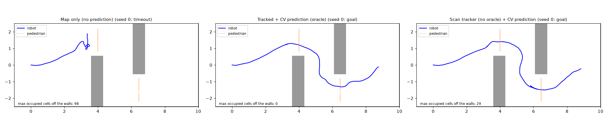

# Dynamic-obstacle MPPI in CudaNav

Status: development surface on `master`, not part of a published release.

The production CUDA MPPI core (`cuda_mppi_controller::MppiGpu`) can avoid
predicted moving obstacles, not only what the costmap shows. This page covers:
- the critic;
- how CudaNav feeds it, from an oracle or from its own scan-based tracker;
- a closed-loop evaluation with pedestrians crossing the S-course.

## Critic

Callers pass tracked obstacles before planning:

```cpp
std::vector<cuda_mppi_controller::DynamicObstacle> tracks = /* x, y, vx, vy, radius */;
planner.setDynamicObstacles(tracks.data(), static_cast<int>(tracks.size()));  // <= 64
```

The tracks are given in the costmap frame and follow constant-velocity motion.
They stay in effect for every following `compute` / `computeWithDeviceCostmap`
call until they are replaced. A count of 0 clears them.

Inside the rollout kernel, at each step `tau = (t + 1) * model_dt`, the
clearance to obstacle `i` is:

```
c = |q(tau) - (p_i + v_i * tau)| - r_i - dynamic_obstacle_robot_radius - dynamic_obstacle_growth * tau
```

The cost depends on `c`:

| Clearance | Cost added |
|---|---|
| `c < 0` | `collision_cost` |
| `0 <= c < dynamic_obstacle_margin` | `dynamic_obstacle_weight * (margin - c)^2 * dt` |
| otherwise | 0 |

A predicted collision adds `collision_cost`. Such rollouts are therefore
counted as invalid, as for costmap collisions, and feed `valid_rollout_ratio`,
`all_colliding` and the retreat behaviour.

The growth term inflates the obstacle with the prediction horizon, standing in
for the uncertainty of the constant-velocity model.

| Parameter | Default | CudaNav default |
|---|---|---|
| `dynamic_obstacle_weight` | 0 (off) | 25 |
| `dynamic_obstacle_margin` | 0.4 m | 0.4 m |
| `dynamic_obstacle_robot_radius` | 0.25 m | 0.25 m |
| `dynamic_obstacle_growth` | 0.1 m/s | 0.1 m/s |
| `dynamic_obstacle_overlap_allowance` | 0 (off) | 0, or 0.1 m with the scan tracker |

**Overlap allowance.** Tracked discs carry position error. Without an
allowance, a robot that a tracking error places just inside a disc sees every
rollout collide, and it freezes. With `dynamic_obstacle_overlap_allowance = a`
greater than 0:
- the robot's current penetration `p` of the observed disc, up to `a`, is
  tolerated: a rollout collides only when it gets deeper than `min(p, a)`
  (judged without the growth term);
- the growth term then enters the soft cost only.

A value of 0 keeps the check in the table above. `CudaNavPipeline` turns the
allowance on, at `TrackerConfig.planner_overlap_allowance = 0.1 m`, only when it
runs the scan tracker.

**Back-out speed.** When every rollout collides, the core backs out by
replaying the last valid plan in reverse, scaled by `retreat_scale`. That
command is clamped to `v_min`. A forward-only robot (`v_min = 0`) therefore
only turned in place, and a robot already close to a pedestrian who was
waiting for it could not get out of the way. `retreat_reverse_speed` (m/s,
default 0) lowers the clamp for the back-out only, to
`min(v_min, -retreat_reverse_speed)`. Normal plans stay forward-only.
CudaNav's forward planner sets it to 0.2 m/s.

**Checked back-out.** Before the back-out command is used, it is held for
`retreat_check_horizon` seconds (default 1.0 s; 0 disables the checks below).
Its translation is dropped, keeping only the turn in place, and
`MppiResult::retreat_blocked` is set, if the command would:
- bring the robot within `dynamic_obstacle_margin` of a predicted dynamic
  obstacle and closer to it than standing still
  (`retreat_avoid_dynamic_obstacles`, default on, used only while the
  critic is active);
- enter a lethal costmap cell costlier than the start cell
  (`retreat_avoid_lethal_cells`, default on).

The costmap check runs as a small kernel on the costmap the rollouts use.
Without a back-out, plans are unchanged.

With the weight at 0, or with no obstacles, the rollout skips the term
entirely. Plans are then bit-identical to the planner without the critic, which
`tests/mppi_dynamic_obstacle_smoke.cu` checks. The native S-course closed loop
is unchanged: 229 frames and 0.153% drift. The Nav2 plugin is also unchanged
unless `dynamic_obstacles_topic` and a positive `dynamic_obstacle_weight` are
set (see below).

## Nav2 input

The Nav2 controller plugin subscribes to tracked objects as
`cuda_robotics_msgs/TrackedObstacleArray` on `dynamic_obstacles_topic`. Each
`TrackedObstacle` has an id, a position, a velocity and a radius, all in the
array's header frame and observed at its stamp. Every control cycle, the
plugin:
- drops a message older than `dynamic_obstacles_timeout` (0.5 s);
- transforms the discs into the costmap frame;
- extrapolates them by the message age;
- hands the 64 nearest to `setDynamicObstacles`.

With `dynamic_obstacles_clear_costmap` (default off), the plugin also clears
the obstacles and their positions over the last second from the copy of the
costmap the rollouts use. This mirrors CudaNav's clearing for costmaps whose
obstacle layers still see the people. Cells that have been lethal for 50
cycles count as structure, and a disc stops short of them by the robot
radius. This clearing is unit-tested (`costmap_clearing_test`) but has not
been evaluated in a closed loop.

The `dynamic_obstacle_*` critic parameters and the back-out parameters are
ROS parameters of the plugin. See the
[plugin README](../ros2_ws/src/cuda_mppi_controller/README.md#tracked-moving-obstacles).

The conversion is tested without ROS or a GPU
(`dynamic_obstacle_input_test`). What is checked:
- the frame transform and the velocity rotation;
- the extrapolation;
- input validation;
- keeping the nearest discs.

`cuda_nav_tracking/scan_tracker_node` publishes the scan tracker's tracks
as `TrackedObstacleArray`:
- **Inputs:** `PointCloud2` scans and a `nav_msgs/OccupancyGrid`, for
  example from `cuda_voxel_mapping`.
- **Outputs:** the tracks, plus the scan without the tracked objects' points.
  Feed that scan to the mapper so moving objects stay out of the map.

The node wraps `cudarobotics.navigation.tracking.ScanTrackingFrontend`, a
middleware-free adapter that is unit-tested in `python/tests`. An in-process
test publishes synthetic TF, grid and scans and checks the published track
and static points. It ran locally with ROS 2 Lyrical. In CI the test is
skipped, because the ROS image has no `cudarobotics` package. The node has
not been run on a robot or against Nav2 end to end. See the
[package README](../ros2_ws/src/cuda_nav_tracking/README.md).

## CudaNav integration

```python
from cudarobotics.navigation import CudaNavPipeline

nav = CudaNavPipeline()
step = nav.step(points_without_tracked_objects, path=path,
                dynamic_obstacles=tracks)  # (N, 5): x, y, vx, vy, radius
```

`dynamic_obstacles` does three things:
- it clears each track's disc, plus 0.15 m, from the occupancy grid, on both
  the device and the host stage chain. Cells occupied for 50 frames (5 s) or
  more count as structure and are not cleared, nor is structure under the
  robot's footprint clearing. This keeps a pedestrian, or the robot, next to
  a wall from erasing the wall. The built-in scan tracker keeps the old
  clearing, because a pedestrian who stood still leaves long-lived cells
  that its history clearing must remove;
- the ESDF and costmap are built from the cleaned grid;
- MPPI receives the tracks as predictions.

Keep the tracked objects' points out of the scan as well. Otherwise the
voxel map keeps them as obstacles, as the baseline below shows.

The planner can also be used on its own:
`cudarobotics.MppiPlanner.set_dynamic_obstacles(rows)`.

## Scan-based tracker

`CudaNavPipeline(tracker=ScanObjectTracker())` finds moving objects in the scan
itself, with no oracle (`cudarobotics.navigation.tracking`). In each frame it
does the following:

1. **Candidates.** `OccupancyAge` keeps, for every cell of the rolling
   occupancy grid, how many consecutive frames it has been occupied. A point is
   a candidate when its 3 x 3 cell block contains no long-standing structure (a
   cell occupied for 20 frames).
   - Walls therefore drop out once they are established, including the half of
     their returns that falls into the free cell in front of the wall surface.
   - Anything new, in free or never-observed space, starts as a candidate.
   - Points near a live track's prediction are added unless they touch
     structure. Points inside a confirmed track's own disc are kept even next
     to a wall.
2. **Clusters.** Candidates are linked within 0.3 m (on distinct xy returns).
   - Clusters wider than 1.0 m, or hit by fewer than 2 rays, are dropped.
   - A scan sees only an object's near side, so the centre is pushed away from
     the sensor by `2 r / pi`, with `r` half the cluster's width.
3. **Tracks.** Clusters are associated greedily within 0.8 m, and each track
   is a constant-velocity Kalman filter.
   - A track is confirmed after 3 detections, once it has moved 0.3 m from
     where it was first seen. Wall fragments jitter in place as different rays
     hit them; a person walks away.
   - A track is deleted after 5 missed frames, or after 2 s supported only by
     points touching structure.
4. **Map gating.** Every detection's points stay out of the voxel map, because
   a moving object integrated even for a few frames leaves lethal traces.
   - An object that does not move for 2 s is released to the map and ages into
     structure. Until then it goes to MPPI as a stationary disc.
   - Confirmed tracks also clear their last 10 s of positions from the
     occupancy grid, which removes traces left before they were confirmed.

The confirmed tracks then go through the same path as `dynamic_obstacles`.
`PipelineStep.tracks`, `track_ids` and `dynamic_point_count` expose the
result. The tracker is NumPy code, and its occupancy-age update copies the
grid to the host every frame.

Its frame cost used to come from two places other than the tracking itself:
- clearing about 100–200 history discs per frame with one synchronising GPU
  call each;
- an all-pairs clustering, which took 8–12 ms on the first 2 s, when every
  point is still a candidate.

Two changes removed both:
- `_CudaNavGridChain.clear_discs` clears all discs in one kernel launch;
- the clustering compares only points in neighbouring grid cells, with
  results identical to before.

On the five-pedestrian crowd layout:

| | Before | After |
|---|---|---|
| Frame p50 | 17.9 ms | 5.6 ms |
| Frame p95 | 34.6 ms | 8.0 ms |
| Tracker update p95 | 8.4 ms | 1.8 ms |

## Crossing evaluation

`cudarobotics-cudanav sim --scenario crossing` runs one S-course traversal
while two pedestrians (discs of radius 0.25 m) walk back and forth across the
two corridors the robot must pass, at 0.5 and 0.4 m/s.
- `--seed` sets their schedule phases.
- They do not steer around the robot, but they pause instead of stepping into
  it. A contact can therefore only come from the robot's own motion.

`--dynamic-mode` selects how the pedestrians reach the planner:

| Mode | Pedestrians in the voxel map | Planner input |
|---|---|---|
| `map` | yes, from LiDAR | none (costmap only) |
| `tracked_static` | removed | tracked positions with zero velocity |
| `predicted` | removed | tracked positions and velocities |
| `tracked_scan` | removed by the scan tracker | the scan tracker's tracks |

In `tracked_static` and `predicted` the tracker is the simulator itself (an
oracle). The `--obs-latency-frames`, `--obs-position-noise-m`,
`--obs-velocity-noise-mps` and `--obs-dropout` options degrade it.
`tracked_scan` uses no simulator knowledge. It also reports tracking accuracy
against the true pedestrians:
- recall: the share of visible pedestrian-frames with a confirmed track within
  0.5 m;
- position and velocity RMSE;
- false tracks: confirmed tracks more than 0.7 m from every pedestrian.

Results from 6 seeds per condition, with the current planner and the
deterministic voxel map (see [Reproducibility](#reproducibility))
([`results/cudanav_dynamic_obstacles_2026-11-22.md`](results/cudanav_dynamic_obstacles_2026-11-22.md),
generated by `scripts/render_cudanav_dynamic_obstacles.py`):

| Condition | Goal reached | Robot-caused collisions | Median time to goal | Median pedestrian yields | Median retreats |
|---|---|---|---|---|---|
| Map only | 0/6 | 0 | - | 9 | 6 |
| Tracked, zero velocity (oracle) | 1/6 | 0 | 58.2 s | 22 | 174 |
| Tracked + prediction (oracle) | 6/6 | 0 | 29.0 s | 5 | 36 |
| Tracked + prediction (oracle, 2-frame delay, 0.05 m / 0.1 m/s noise) | 6/6 | 0 | 32.7 s | 32 | 55 |
| Scan tracker + prediction (no oracle) | 6/6 | 0 | 35.1 s | 37 | 74 |

Scan tracker accuracy over its 6 runs: 88.2% recall, a median position RMSE of
0.10 m, a median velocity RMSE of 0.27 m/s, and 1.13 false tracks per frame.



What the runs show:
- **Map only.** The robot never collides, but it never arrives.
  - Each pedestrian's sweep leaves lethal cells across the corridor: up to
    108 occupied cells away from the walls. The voxel map clears them only
    slowly, so the robot circles in front of the first corridor.
  - The planar scan's ±0.45 m returns rarely pass back through those voxels,
    which is why they persist.
- **Tracked, zero velocity.** Keeping the pedestrians out of the map removes
  the trails. However, a planner that treats them as static keeps steering
  into their path, and 5 of 6 runs timed out.
- **Tracked + prediction (oracle).** All 6 runs reached the goal (median
  29.0 s) with no robot-caused collision.
- **Delay and noise.** All 6 runs reached the goal (median 32.7 s) with no
  robot-caused collision.
- **Scan tracker.** With no oracle, all 6 runs reached the goal (median
  35.1 s), with no robot-caused collision.
  - Recall is 88.2%, against perfect tracks for the oracle.
  - Up to 54 occupied cells away from the walls remain where tracking briefly
    lost a pedestrian.
  - Without the overlap allowance, the same tracker reached the goal in 0 of 6
    runs (measured before the back-out change): the robot froze whenever a
    position error placed it inside a disc.

**What the back-out speed changed.** The previous results
([`results/cudanav_dynamic_obstacles_2026-11-21.md`](results/cudanav_dynamic_obstacles_2026-11-21.md))
had a back-out clamped to `v = 0`.

| Condition | Goal reached | Robot-caused collisions |
|---|---|---|
| Oracle prediction | 5/6 → 6/6 | 0 → 0 |
| Delay and noise | 4/6 → 6/6 | 12 → 0 |
| Scan tracker | 4/6 → 6/6 | 0 → 0 |

Every failure and every contact came from the same situation:
1. A pedestrian stopped close to the robot, waiting for it to clear the
   pedestrian's path.
2. The robot saw every rollout collide:
   - with noisy tracks, because the observed disc overlapped it;
   - even with exact tracks, because the growth term inflates a stopped
     pedestrian over the horizon until standing still also collides.
3. Its back-out could only turn in place, so neither side moved.
4. The contacts happened when a noisy track briefly looked farther away: the
   robot drove forward from that pose and hit the pedestrian.

Before the change, the back-out was the leading suspect for the contacts,
because it is not checked against the predicted obstacles. In fact, none of
the 12 contacts came from a back-out command. All 12 came from normal plans
that still had valid rollouts.

Other changes tried on the delay-and-noise condition:

| Change | Goal reached | Robot-caused collisions |
|---|---|---|
| Overlap allowance 0.1 m | 5/6 | 19 |
| Growth term in the soft cost only | 5/6 | 37 |
| Robot radius 0.35 m plus allowance 0.15 m | 4/6 | 0 |
| `v_min = -0.2` for every plan, with radius 0.30–0.35 m and the allowance | 3/6–4/6 | 0 |

Allowing reverse in every plan broke path following, so the reverse motion
is limited to the back-out.

The cost, as measured when the change was made, is time on runs that
already succeeded, because the robot now backs off where it used to squeeze
past:
- oracle seeds 1 and 2 took 34.9 s and 31.5 s, against 26.4 s and 24.3 s
  before;
- the oracle median rose from 25.9 s (over 5 runs) to 31.0 s (over 6).

## Harder pedestrian layouts

With the back-out able to reverse, the crossing scenario no longer separates
the conditions. `--layout` adds three harder layouts to
`sim --scenario crossing`. In these layouts a pedestrian who has waited 3 s
for the robot turns around. In `crossing` pedestrians wait indefinitely, so
its results are unchanged.

| Layout | Pedestrians |
|---|---|
| `crossing` | two cross the corridors (the scenario above) |
| `head_on` | two walk the corridors along the robot's line, against it |
| `overtake` | the two crossing pedestrians plus one at 0.65 m/s walking the robot's route, starting 0.9 m behind it |
| `crowd` | five pace random wall-free segments (seeded) |

Results from 6 seeds × 3 conditions × 4 layouts
([`results/cudanav_pedestrian_layouts_2026-11-22.md`](results/cudanav_pedestrian_layouts_2026-11-22.md),
generated by `scripts/render_cudanav_pedestrian_layouts.py`). "Before" is the
unchecked back-out of the previous section. "After" is the current planner,
rerun with the deterministic voxel map; the column in brackets is the first
measurement of the back-out checks, with the old order-dependent map.

| Layout | Goal reached: before → after (first) | Robot-caused collisions: before → after (first) |
|---|---|---|
| Crossing | 18/18 → 18/18 (18/18) | 0 → 0 (1) |
| Head-on | 14/18 → 16/18 (13/18) | 5 → 3 (0) |
| Overtake | 14/18 → 15/18 (16/18) | 703 → 1 (1) |
| Crowd | 13/18 → 16/18 (15/18) | 115 → 1 (0) |
| All | 59/72 → 65/72 (62/72) | 823 → 5 (2) |

The three head-on contacts all happen in one run with delayed, noisy tracks.

How the runs were checked:
- **Before.** The unchecked back-out caused 821 of the 823 collisions (all
  in reverse): the robot backed into the pedestrian following it, into crowd
  members and, on head-on runs, into walls.
- **Back-out checks.** Checking the back-out against the predicted obstacles
  alone stopped the pedestrian contacts. The robot then backed into walls
  instead (98 wall collisions in one run), which the lethal-cell check
  stopped.
- **Wall clearing.** The checks exposed a mapping bug. Clearing a tracked
  pedestrian's disc, or the robot's own footprint, also erased the wall
  beside it; the robot then saw free space and drove into the wall (58 wall
  collisions in one run). Sparing cells occupied for 5 s or more fixed it.
- **Remaining contacts.** In the first measurement, the two remaining
  contacts were:
  - one with delayed, noisy tracks;
  - one in reverse, when the scan tracker had not detected the pedestrian
    behind the robot.

The remaining failures are timeouts, spread over `head_on`, `overtake` and
`crowd`. In head-on encounters, as a pedestrian comes towards the robot along
a corridor, every rollout collides with the prediction for many frames, and
the forward-only robot backs off or turns in place instead of passing beside
them.

Two other changes were tried and not adopted:
- **Collision horizon.** Counting a predicted overlap as a collision only
  within the first 1.0 s or 1.5 s, and as a soft cost after that, raised
  the goal count to 68/72 in one sweep. However, it produced 58–344
  collisions per sweep.
- **Sparing structure with the scan tracker.** It dropped the crossing goal
  count from 6/6 to 4/6. A pedestrian who stood still leaves cells that live
  for more than 5 s, and they then could not be cleared from under the robot.

### Steering away instead of backing out (opt-in)

In the failed head-on runs the same cycle repeats:
1. The robot drives along the corridor towards a pedestrian coming the
   other way.
2. Once every rollout collides with the prediction, it backs off at 0.2 m/s.
3. The pedestrian follows at 0.4 m/s and pushes it back about 1.5 m.
4. The robot never moves aside.

`evade_min_collision_time` (s, default 0 = off) changes the decision when
every rollout collides:
- the kernel records each rollout's first colliding step;
- if the latest first collision is at least this far ahead, the core follows
  the optimizer's plan, which steers away, instead of backing out;
- the result reports `evading` and `time_to_collision`;
- that plan is not stored as a valid sequence to back out along.

The costs themselves do not change, unlike the collision horizon above.

With the old order-dependent voxel map (see
[Reproducibility](#reproducibility)), 1.0 s seemed to fix most head-on
standoffs: head-on goals rose from 13/18 to 17/18 in two sweeps each, while
robot-caused collisions rose from 2 to 7–9.

Rerun with the deterministic map, the default already reaches 16 of the 18
head-on goals, and evading no longer pays. Two variants of the evading
command were also tried:
- executing the sampled rollout whose first collision comes latest, instead
  of the softmin average, which can blend rollouts that dodge to opposite
  sides;
- capping the evading speed at 0.25 m/s.

72 runs per setting:

| Setting | Goal reached | Head-on goals | Robot-caused collisions |
|---|---|---|---|
| Off (default) | 65/72 | 16/18 | 5 |
| `evade_min_collision_time = 1.0` | 62/72 | 16/18 | 35 |
| 1.0 s, latest rollout | 59/72 | 16/18 | 20 |
| 1.0 s, latest rollout, 0.25 m/s cap | 66/72 | 17/18 | 17 |
| 1.0 s, 0.25 m/s cap | 62/72 | 16/18 | 24 |

- Every evading setting adds collisions.
- Most of them come from `overtake` with the scan tracker, where the robot
  steers on with a pedestrian close behind it, and from one degraded crowd
  run (30 collisions).
- The best setting gains one goal for 12 more collisions.

Evasion therefore stays off by default, in the core and in CudaNav, and the
two variants were not added. The Python binding and the Nav2 plugin expose
`evade_min_collision_time`.

### Where the remaining failures come from

Because the loop is deterministic, `scripts/analyze_cudanav_layout_failures.py`
can replay all 72 default runs exactly (same goals and collisions) with
per-frame instrumentation
([`results/cudanav_layout_failures_2026-11-23.md`](results/cudanav_layout_failures_2026-11-23.md)).

A frame is *stalled* when the robot gains less than 0.10 m of route over the
next 2 s. Each stalled frame is labelled by its likely cause. With a
pedestrian within 0.6 m of the robot's edge:
- `wait`: the planner still has collision-free rollouts;
- `pushed_back`: every rollout collides and the pedestrian advances at least
  0.10 m against the robot's heading;
- `backout`: every rollout collides otherwise.

Without a pedestrian nearby: `ghost` (non-wall occupied cells within 1 m),
`false_track` (a planner obstacle that no pedestrian explains) or `other`.

Stalled seconds over the 18 runs of each layout:

| Layout | pushed_back | backout | wait | ghost | false_track | other |
|---|---|---|---|---|---|---|
| Crossing | 14.2 | 25.6 | 6.2 | 0.0 | 0.0 | 1.2 |
| Head-on | 111.5 | 37.4 | 35.7 | 0.0 | 0.0 | 26.8 |
| Overtake | 31.4 | 73.8 | 21.8 | 0.0 | 0.0 | 0.3 |
| Crowd | 79.8 | 56.0 | 44.4 | 9.6 | 0.0 | 23.6 |
| All | 236.9 | 192.8 | 108.1 | 9.6 | 0.0 | 51.9 |

- **Stalls near pedestrians.** 90% of the stalled time has a pedestrian
  within 0.6 m. Most of it (80%) is spent with every rollout colliding:
  - with a forward-only planner, an approaching constant-velocity prediction
    leaves no collision-free rollout at close range;
  - the robot then backs out at 0.2 m/s;
  - the pedestrian follows, because it only pauses while its next step would
    touch the robot;
  - since the robot keeps making room, the pedestrian never waits the 3 s
    after which it would turn around.

  Of the 7 missed goals:
  - the four in head-on and crowd have no pedestrian turnarounds and
    reverse 3.9–4.8 m in total;
  - in crowd seed 2 (scan tracker), the robot never gets past 1.4 m of its
    12.5 m route after the first 5 s;
  - the three in overtake are slower losses: 3–5 turnarounds and 0.8–2.3 m
    of reversing, ending at 9.6–12.1 m.
- **Map and tracker errors are not the cause.** False tracks never stall the
  robot. Ghost cells account for 9.6 s, all in two crowd runs with the scan
  tracker, and even there a pedestrian is the main cause.
- **Collisions.** Four of the five robot-caused collisions are the same event:
  - the input is delayed and noisy;
  - the robot is 0.01–0.04 m from a pedestrian who has stopped to yield;
  - noise in the reported position (0.04–0.10 m) briefly leaves some
    rollouts collision-free;
  - the softmin command is then full speed (0.55 m/s) forward, which closes
    the gap within one frame.

  The fifth is a back-out with the scan tracker, into a pedestrian behind the
  robot whose track was merged with a neighbour and placed 0.39 m away.

Not backing out at all is worse. With `retreat_reverse_speed = 0` the robot
only turns in place when every rollout collides. A partial sweep, stopped
after 35 of the 72 runs, gave:
- crossing: 11/18 goals and 8 collisions, against 18/18 and 0;
- head-on: 12/17 goals, against 15/17 for the same runs by default.

Reducing false tracks would therefore not change these results. What remains
is how the robot deals with a pedestrian who comes towards it at close range.

### Yielding obstacles (opt-in)

`dynamic_obstacle_yield_distance` (m, default −1 = off) changes the
prediction of an obstacle that approaches the robot. Its constant-velocity
prediction, and its uncertainty growth, stop at the moment it first comes
within this distance of the robot's disc at the start pose. Obstacles that
move away or pass by are unchanged. This models a person who stops or steps
aside instead of walking into a standing robot. Standing still, or stepping
aside, is then collision-free, so the robot no longer has to back out.

72 runs per setting (the default row is the sweep above):

| Setting | Crossing | Head-on | Overtake | Crowd | All goals | Robot-caused collisions | Stalled time |
|---|---|---|---|---|---|---|---|
| Default | 18/18 | 16/18 | 15/18 | 16/18 | 65/72 | 5 | 599 s |
| Yield distance 0.05 m | 18/18 | 17/18 | 17/18 | 17/18 | 69/72 | 13 | 440 s |

By tracker:

| Tracks | Default: goals, collisions | Yield 0.05 m: goals, collisions |
|---|---|---|
| Oracle | 21/24, 0 | 23/24, 0 |
| Delayed + noisy | 22/24, 4 | 24/24, 8 |
| Scan tracker | 22/24, 1 | 22/24, 5 |

- **Oracle tracks.** Yielding gains two goals and adds no collisions.
- **Noisy or scanned tracks.** The added collisions are again mostly
  full-speed forward commands into a pedestrian a few centimetres away,
  and one scan-tracker run where the pedestrian was not tracked (its track
  was 0.8–1.3 m away).
- **Larger distance.** 0.15 m was worse on the two layouts measured: head-on
  15/18 with 7 collisions, crowd 17/18 with 3.

Yielding therefore stays off by default. The core and the Python binding
expose it; the Nav2 plugin does not yet.

Two other fixes for the contacts were tried and not adopted. Both reduce
the speed near pedestrians, which keeps the robot in their way for longer:
- **Approach-speed limit.** Capping the command's speed towards each
  obstacle in proportion to the gap:
  - 2 /s with a 0.1 m buffer: crossing 10/18 with 67 collisions, head-on
    14/18;
  - 4 /s with 0.03 m: crossing 17/18 with 5 collisions, head-on 12/18.
- **Acceleration limit.** Limiting the executed speed change to 1 m/s², on
  top of yielding (the planner still assumes instant changes): 66/72 goals
  and 31 collisions. Head-on improves to 18/18 with no collision, but crowd
  drops to 13/18.

## Reproducibility

Closed-loop runs used not to be bit-reproducible:
- reruns of the same seed diverged after some tens of frames, first as a
  one-cell difference in the occupancy grid;
- one configuration went from 118 collisions to 0 when rerun, so differences
  of one or two runs out of 18 were within the noise.

The cause was the voxel map. Each ray updated the log-odds of the voxels it
crossed with a clamped float compare-and-swap, so a voxel reached by many rays
in one scan ended with a value that depended on the order in which the rays
arrived. The integration now takes two passes:
1. the rays count their free and occupied updates per voxel in a 64-bit
   integer (`atomicAdd`, which commutes);
2. one thread per voxel adds all of a scan's updates at once and clamps.

The rest of the loop was already deterministic: the MPPI sampler has a fixed
seed, and its reductions (CUB) and rollouts use no float atomics.

- Reruns of the crossing scenario (oracle, and scan tracker on `head_on` and
  `crowd`) are now identical frame by frame.
- `tests/voxel_mapping_gpu_smoke.cu` integrates a fan of rays forward and
  reversed and requires bit-identical maps; the old kernel fails it.
- Clamping once per scan, instead of after every ray, changes the map
  slightly. All results on this page were rerun, except the comparisons
  marked as measured with the old map.

## Limits

- **Synthetic.** The world, LiDAR and plant are synthetic. The scan tracker
  has only been evaluated on this simulator's planar three-layer scan and
  disc-shaped pedestrians.
- **Tracker assumptions.** It is a 2-D, model-free tracker:
  - a person who stands still for 2 s before ever moving becomes map
    structure;
  - one who stays in contact with a wall can merge into it;
  - it is NumPy code on the host (about 1 ms per frame at p50); only the
    map clearing runs on the GPU.
- **Back-out.** The back-out is checked only against tracked obstacles and
  the costmap. An undetected person behind the robot is still at risk, which
  caused one contact with the scan tracker. The robot resolves standoffs by
  giving way, which costs time; nothing reasons about who should go first.
- **Head-on encounters.** By default, a pedestrian walking towards the robot
  along a corridor still makes every rollout collide with its prediction for
  many frames, and 2 of the 18 head-on runs time out. Steering on instead
  of backing out (`evade_min_collision_time`) does not help: it gains at
  most one goal and adds collisions (see above). Predicting that the
  pedestrian yields (`dynamic_obstacle_yield_distance`) gains goals. With
  noisy tracks, however, it also adds contacts.
- **Contacts under noisy tracks.** With tracks a few centimetres off, the
  planner can briefly see room in front of a pedestrian it is almost
  touching, and drive forward at full speed. Speed or acceleration limits
  did not fix this without costing goals.
- **Simple motion model.** The prediction is constant velocity, and the
  pedestrians move in straight lines with turnarounds.
- **Small clearances.** Minimum clearances stay around 0.05 m in every
  condition, partly because the pedestrians pause at 0.05 m.
- **ROS 2 path tested in pieces only.** `cuda_nav_tracking` publishes
  `TrackedObstacleArray`, and the plugin consumes it. However, the tracker
  node has only been tested in-process with synthetic messages, and the
  closed-loop results above come from the Python pipeline, not from Nav2.
