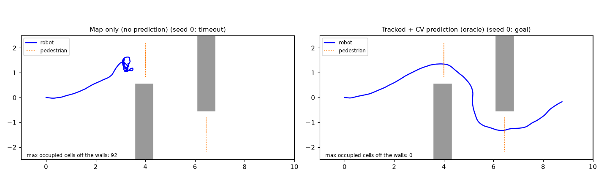

# Dynamic-obstacle MPPI in CudaNav

Status: development surface on `master`, not part of a published release.

The production CUDA MPPI core (`cuda_mppi_controller::MppiGpu`) can avoid
predicted moving obstacles, not only what the costmap shows. This page covers:
- the critic;
- how CudaNav feeds it;
- a closed-loop evaluation with pedestrians crossing the S-course.

## Critic

Callers pass tracked obstacles before planning:

```cpp
std::vector<cuda_mppi_controller::DynamicObstacle> tracks = /* x, y, vx, vy, radius */;
planner.setDynamicObstacles(tracks.data(), static_cast<int>(tracks.size()));  // <= 64
```

The tracks are given in the costmap frame and follow constant-velocity motion.
They stay in effect for every following `compute` / `computeWithDeviceCostmap`
call until they are replaced. A count of 0 clears them.

Inside the rollout kernel, at each step `tau = (t + 1) * model_dt`, the
clearance to obstacle `i` is:

```
c = |q(tau) - (p_i + v_i * tau)| - r_i - dynamic_obstacle_robot_radius - dynamic_obstacle_growth * tau
```

The cost depends on `c`:

| Clearance | Cost added |
|---|---|
| `c < 0` | `collision_cost` |
| `0 <= c < dynamic_obstacle_margin` | `dynamic_obstacle_weight * (margin - c)^2 * dt` |
| otherwise | 0 |

A predicted collision adds `collision_cost`. Such rollouts are therefore
counted as invalid, as for costmap collisions, and feed `valid_rollout_ratio`,
`all_colliding` and the retreat behaviour.

The growth term inflates the obstacle with the prediction horizon, standing in
for the uncertainty of the constant-velocity model.

| Parameter | Default | CudaNav default |
|---|---|---|
| `dynamic_obstacle_weight` | 0 (off) | 25 |
| `dynamic_obstacle_margin` | 0.4 m | 0.4 m |
| `dynamic_obstacle_robot_radius` | 0.25 m | 0.25 m |
| `dynamic_obstacle_growth` | 0.1 m/s | 0.1 m/s |

With the weight at 0, or with no obstacles, the rollout skips the term
entirely. Plans are then bit-identical to the planner without the critic, which
`tests/mppi_dynamic_obstacle_smoke.cu` checks. The native S-course closed loop
is unchanged: 229 frames and 0.153% drift. The Nav2 plugin does not have an
obstacle input yet, so its behaviour is also unchanged.

## CudaNav integration

```python
from cudarobotics.navigation import CudaNavPipeline

nav = CudaNavPipeline()
step = nav.step(points_without_tracked_objects, path=path,
                dynamic_obstacles=tracks)  # (N, 5): x, y, vx, vy, radius
```

`dynamic_obstacles` does three things:
- it clears each track's disc, plus 0.15 m, from the occupancy grid, on both
  the device and the host stage chain;
- the ESDF and costmap are built from the cleaned grid;
- MPPI receives the tracks as predictions.

Keep the tracked objects' points out of the scan as well. Otherwise the
voxel map keeps them as obstacles, as the baseline below shows.

The planner can also be used on its own:
`cudarobotics.MppiPlanner.set_dynamic_obstacles(rows)`.

## Crossing evaluation

`cudarobotics-cudanav sim --scenario crossing` runs one S-course traversal
while two pedestrians (discs of radius 0.25 m) walk back and forth across the
two corridors the robot must pass, at 0.5 and 0.4 m/s.
- `--seed` sets their schedule phases.
- They do not steer around the robot, but they pause instead of stepping into
  it. A contact can therefore only come from the robot's own motion.

`--dynamic-mode` selects how the pedestrians reach the planner:

| Mode | Pedestrians in the voxel map | Planner input |
|---|---|---|
| `map` | yes, from LiDAR | none (costmap only) |
| `tracked_static` | removed | tracked positions with zero velocity |
| `predicted` | removed | tracked positions and velocities |

The tracker is the simulator itself (an oracle). The
`--obs-latency-frames`, `--obs-position-noise-m`, `--obs-velocity-noise-mps`
and `--obs-dropout` options degrade it.

Results from 3 seeds per condition
([`results/cudanav_dynamic_obstacles_2026-11-21.md`](results/cudanav_dynamic_obstacles_2026-11-21.md),
generated by `scripts/render_cudanav_dynamic_obstacles.py`):

| Condition | Goal reached | Robot-caused collisions | Median time to goal | Median pedestrian yields | Median retreats |
|---|---|---|---|---|---|
| Map only | 0/3 | 0 | - | 0 | 58 |
| Tracked, zero velocity | 1/3 | 0 | 53.6 s | 186 | 138 |
| Tracked + prediction (oracle) | 3/3 | 0 | 24.3 s | 0 | 13 |
| Tracked + prediction (2-frame delay, 0.05 m / 0.1 m/s noise) | 3/3 | 0 | 39.3 s | 86 | 105 |



What the runs show:
- **Map only.** The robot never collides, but it never arrives.
  - Each pedestrian's sweep leaves lethal cells across the corridor: up to
    108 occupied cells away from the walls. The voxel map clears them only
    slowly, so the robot circles in front of the first corridor.
  - The planar scan's ±0.45 m returns rarely pass back through those voxels,
    which is why they persist.
- **Tracked, zero velocity.** Keeping the pedestrians out of the map removes
  the trails. However, a planner that treats them as static keeps steering into
  their path: pedestrians had to pause for it in 186 frames (median), and 2 of
  3 runs timed out.
- **Tracked + prediction.** All runs reached the goal with no robot-caused
  collision, and no pedestrian had to yield to the robot.
- **Delay and noise.** Two frames of delay and noise slow the robot (median
  39.3 s) and make pedestrians yield again (86 frames), but every run still
  succeeds.

## Limits

- **Synthetic and oracle-tracked.** The world, LiDAR and plant are synthetic.
  The tracks come from the simulator, not from a perception stack.
  `LidarObjectPipeline` tracks cars and vans only, so a scan-based pedestrian
  tracker is a separate next step.
- **Simple motion model.** The prediction is constant velocity, and the
  pedestrians move in straight lines with turnarounds.
- **Small clearances.** Minimum clearances stay around 0.05 m in every
  condition, partly because the pedestrians pause at 0.05 m.
- **No Nav2 input yet.** The Nav2 controller plugin has no input path for
  predicted obstacles yet (a topic and message type).
